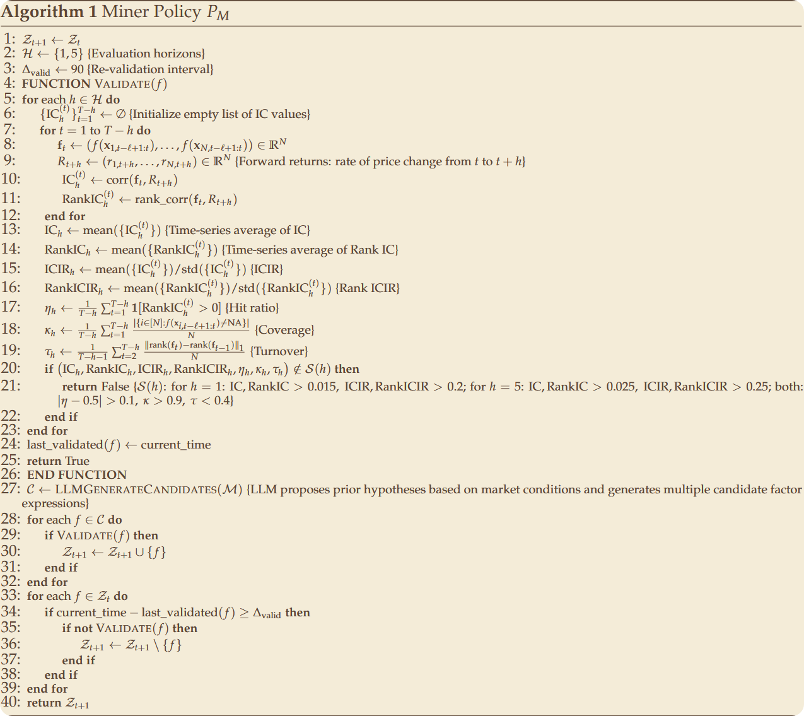
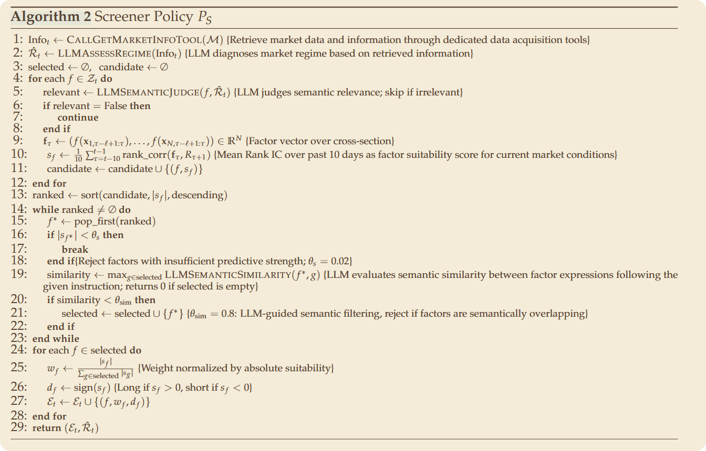
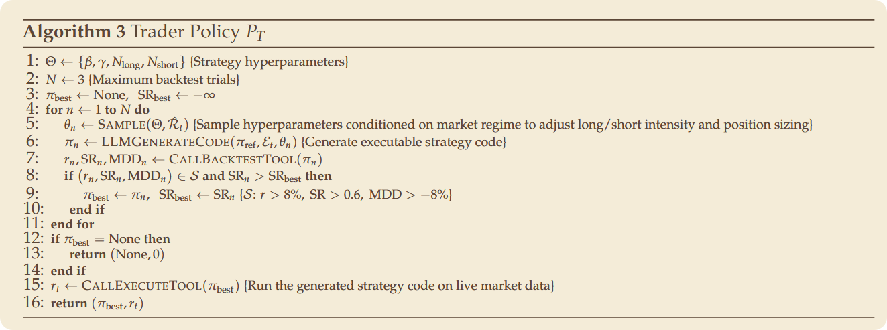

Yishuo Yuan、Jiayi Sheng、Sirui Zeng、Jiaqi Wang、Jiaheng Liu，**“AlphaCrafter: Harnessing Multi-Agent Workflows for Cross-Sectional Quantitative Trading”**，南京大学，2026。

论文链接：[arXiv:2605.05580v2](https://arxiv.org/abs/2605.05580v2) · [PDF](https://arxiv.org/pdf/2605.05580v2)

本文以 2026 年 7 月更新的 v2 为准。arXiv 元数据标注为 **Submitted to AAAI 2027**，即投稿状态，不应写成已被会议录用。

AlphaCrafter 最值得讨论的，不是“让几个 LLM 一起选股票”，而是下面这个问题：

> 怎样让一个能够适应市场的 Agent，同时遵守可检查的流程、风险边界和终止条件？

本文沿着原始笔记的思路，整理研究动机、数学定义和三个 Harness，并依据原论文补充尚未完成的实验部分。文中的结果均为作者报告，未经独立复现；论文所称的 **Live Trading 使用券商 paper-trading API，本文称为实时模拟交易，不等同于真实资金实盘**。

## 一、研究动机：预测能力之外，还需要执行一致性

### 市场为什么需要动态适应？

论文首先把金融市场描述为高维、非线性的动态系统，强调三种现象：

- **厚尾（heavy tails）**：极端收益出现的概率可能高于简单正态模型的估计。
- **波动率聚集（volatility clustering）**：高波动往往接着高波动，低波动也可能持续。
- **跨截面依赖（cross-sectional dependencies）**：不同股票并不独立，会共同受到行业、市场和流动性冲击。

收益同时受到宏观经济状态、市场微观结构摩擦和行为反馈影响。这里的宏观状态包括通胀、利率、经济扩张或衰退，以及 risk-on/risk-off；微观结构涉及买卖价差、流动性、订单流和交易成本；行为反馈则包含预期、追涨杀跌等相互强化的行为。

这并不构成“静态策略绝不可能盈利”的证明，但说明了一个实际问题：**一个过去有效的信号，在市场状态变化后可能衰减，甚至反向。**

传统量化方法从因子模型发展到 XGBoost、LightGBM，再到 LSTM、Transformer，非线性建模能力不断提高。然而，特征、架构和优化目标仍常常由研究员预先设定。预测模型更强，不等于研究流程已经能够自主适应。

### 两类 LLM 交易系统的不足

论文将已有工作概括为两条路线：

| 路线                       | 典型做法                                        | 作者关注的问题                                                   |
| -------------------------- | ----------------------------------------------- | ---------------------------------------------------------------- |
| 角色扮演式交易委员会       | 基本面、技术面、组合和风控 Agent 讨论后形成决策 | 多轮对话引入延迟，也可能放大行为偏差                             |
| 因子与工具驱动的量化 Agent | 自动发现因子、回测策略并调用执行工具            | 工作流若主要靠松散提示词规定，执行顺序、验证和行为一致性可能不足 |

这里的重点不是否定多 Agent 讨论，也不是证明所有既有系统都缺乏约束，而是把研究问题从“能否提出好策略”推进到“能否稳定执行研究流程”。

一个偶尔预测很准、却会跳过验证或随意改变规则的 Agent，未必比一个预测稍弱但执行稳定的系统更适合长期运行。

### Harness 到底是什么？

在这里，**Harness 是围绕 LLM 的结构化执行框架**，而不只是更长的提示词。它把三件事显式化：

1. **可编程策略规范**：当前状态下应该执行哪一步，使用什么输入，产出什么结果。
2. **执行约束**：最多尝试多少次，哪些候选不可接受，什么时候必须停止。
3. **验证机制**：通过工具计算指标、检查条件，再决定能否进入下一阶段。

可以把它理解成：**LLM 负责生成假设和进行语义判断，Harness 负责组织流程与把关，计算工具负责数值验证。**

作者将其定位为首个面向横截面量化交易的 Harness 驱动多智能体框架。这是论文的优先性主张；更值得关注的是它具体约束了哪些行为，以及这些约束带来了什么实验收益。

## 二、问题定义：从原始数据到横截面信号

### 交易环境与因子库

论文将交易环境写为：

$$
\mathcal{E}=(\mathcal{T},\mathcal{M},\mathcal{Z},\Pi).
$$

其中，$\mathcal{T}=\{1,\ldots,T\}$ 表示交易日，$\mathcal{M}$ 是市场状态空间，$\mathcal{Z}$ 是动态因子库，$\Pi$ 是允许采用的策略空间。策略空间受组合构建规则和风险约束限制。

设可交易资产集合 $\mathcal{U}$ 有 $N$ 个资产，原始数据为：

$$
\mathcal{X}\in\mathbb{R}^{N\times T\times P}.
$$

三个维度分别是资产、交易日和特征。元素 $x_{i,t}^{(p)}$ 表示资产 $i$ 在日期 $t$ 的第 $p$ 个特征，例如 OHLCV 中的开盘价、最高价、最低价、收盘价或成交量。实验还使用基本面、财务报表与新闻等数据。

一个因子被形式化为：

$$
f:\mathbb{R}^{\ell\times P}\rightarrow\mathbb{R},
$$

也就是接收某个资产过去 $\ell$ 个时点的特征窗口，输出一个标量信号。对同一天的所有资产分别计算，可得到横截面向量：

$$
\mathbf{f}_t=
\left(
 f(\mathbf{x}_{1,t-\ell+1:t}),\ldots,
 f(\mathbf{x}_{N,t-\ell+1:t})
\right)\in\mathbb{R}^{N}.
$$

**横截面交易关注同一时点不同资产之间的相对强弱**，而不是只预测一只股票明天涨不涨。

### IC 与 Rank IC：数值关系不等于排序关系

令 $\mathbf{R}_{t,t+h}$ 表示从 $t$ 到 $t+h$ 的各资产未来收益。这里特意写出区间，避免把多日累计收益误读成第 $t+h$ 天的单日收益。

普通 IC 使用 Pearson 相关系数：

$$
\operatorname{IC}^{(h)}_t
=\operatorname{PearsonCorr}(\mathbf{f}_t,\mathbf{R}_{t,t+h}).
$$

展开为：

$$
\operatorname{IC}^{(h)}_t=
\frac{\sum_{i=1}^{N}(f_{i,t}-\bar f_t)(R_{i,t,t+h}-\bar R_{t,t+h})}
{\sqrt{\sum_{i=1}^{N}(f_{i,t}-\bar f_t)^2}
 \sqrt{\sum_{i=1}^{N}(R_{i,t,t+h}-\bar R_{t,t+h})^2}}.
$$

它检查的是：因子值高于横截面平均的资产，未来收益是否也倾向于高于平均。正值表示同向关系，负值表示反向关系，接近零则说明线性关系较弱。

Rank IC 则使用 Spearman 相关：

$$
\operatorname{RankIC}^{(h)}_t
=\operatorname{PearsonCorr}
\left(\operatorname{rank}(\mathbf{f}_t),
\operatorname{rank}(\mathbf{R}_{t,t+h})\right).
$$

所以，**IC 看数值的线性关系，Rank IC 看排序的单调关系**。不能把普通 IC 直接解释成“预测排名与真实排名有多一致”。

例如，某日四只股票的因子为 $(4,3,2,1)$，未来收益为 $(8\%,6\%,3\%,1\%)$：IC 接近 1，Rank IC 则为 1，因为两者排序完全一致。

论文把满足预测能力阈值的因子称为 alpha。不过，**经验 IC 超过阈值，不自动等于完成了严格的统计显著性检验**。大量搜索因子时，仍需考虑样本长度、多重检验和样本外验证。

### 两种记忆

- **上下文记忆**：将当前市场信息、任务状态等放进 Agent 的提示词。
- **持久化长期记忆**：共享记录选过的因子、执行过的策略和绩效结果，供后续 Agent 获取反馈。

前者负责“现在发生了什么”，后者负责“过去做过什么、效果如何”。两者共同支持闭环适应，但保存记录本身不保证策略有效。

## 三、Miner Cluster：生成、验证与淘汰因子

系统的主流程可以概括为：

```text
市场数据与共享记忆
        ↓
Miner Cluster：生成候选 → 逐个验证 → 更新因子库
        ↓
Screener：判断市场状态 → 筛选因子 → 分配权重与方向
        ↓
Trader：实例化策略 → 有限次回测 → 风险检查 → 执行
        ↓
绩效与轨迹写入共享记忆，供后续决策使用
```

Miner 的状态转换为：

$$
\mathcal{A}_M(\mathcal{Z}_t,\mathcal{M})
\xrightarrow{P_M}\mathcal{Z}_{t+1}.
$$

LLM 根据市场状态提出候选表达式，但不能仅凭“经济逻辑听起来合理”就把它加入因子库。



### 因子入库需要通过什么检查？

算法 1 在 $h\in\{1,5\}$ 两个预测期限上检查：

| 指标            | 检查内容                                     |
| --------------- | -------------------------------------------- |
| IC、Rank IC     | 数值关系和排序关系是否具有预测性             |
| ICIR、Rank ICIR | 预测表现沿时间是否稳定                       |
| Hit ratio       | 正向 Rank IC 出现的时间比例，按算法 1 的定义 |
| Coverage        | 能输出有效值的资产比例                       |
| Turnover        | 相邻日期因子排名的变化程度                   |

其中：

$$
\operatorname{ICIR}_h=
\frac{\operatorname{mean}_t(\operatorname{IC}^{(h)}_t)}
{\operatorname{std}_t(\operatorname{IC}^{(h)}_t)}.
$$

这是 IC 序列的均值与标准差之比，不是组合收益的 Sharpe Ratio；论文这里也没有附加年化系数。

算法给出的经验门槛为：

| 预测期限 | IC 与 Rank IC | ICIR 与 Rank ICIR |
| -------- | ------------- | ----------------- |
| 1 日     | 均大于 0.015  | 均大于 0.2        |
| 5 日     | 均大于 0.025  | 均大于 0.25       |

两个期限还需满足 $|\eta-0.5|>0.1$、$\kappa>0.9$、$\tau<0.4$，分别对应命中率、覆盖率和排名变化指标。这里严格保留原式：命中率条件是偏离 0.5，而不只是“高于 60%”。这些阈值是论文的设计选择，不是所有市场通用的标准。

还有一个容易混淆的地方：论文的 turnover 是平均绝对排名变化，**不是账户实际交易金额对应的组合换手率**。其尺度依赖排名的表示方式，复现时需要核对实现，不能把 $\tau<0.4$ 直接解释成“交易换手率低于 40%”。

### 因子库也需要维护

候选通过验证后入库；已有因子到达复检间隔后重新验证，不合格则删除。算法设定 $\Delta_{\text{valid}}=90$，复现时还需明确该时间计数采用交易日还是其他时间单位。

一轮中生成的候选全部验证完成，就结束本轮探索。这一点体现了 Harness 的边界：不是让 Agent 一直试到获得满意答案，而是给探索过程一个明确的停止点。

我的理解是，Miner 的价值不只在“自动写因子”，还在于把**提出假设、历史验证、持久化和失效淘汰**组合成一个生命周期。

## 四、Screener：从有效因子中选出当前适用的组合

一个因子历史上有效，不代表它适合当前市场。Screener 要完成的是：

$$
\mathcal{A}_S(\mathcal{Z}_t,\mathcal{M})
\xrightarrow{P_S}(\mathcal{E}_t,\hat{\mathcal{R}}_t),
$$

其中 $\hat{\mathcal{R}}_t$ 是估计的市场状态，$\mathcal{E}_t$ 是输出的因子组合。



### 从市场判断到数值评分

算法先调用工具获得市场信息，再由 LLM 判断趋势、波动、相关性结构等市场特征，过滤掉语义上不适合当前状态的因子。

对保留下来的因子，以过去 10 日的平均单日 Rank IC 计算适配度：

$$
s_f=\frac{1}{10}\sum_{\tau=t-10}^{t-1}
\operatorname{RankCorr}(\mathbf{f}_{\tau},\mathbf{R}_{\tau,\tau+1}).
$$

然后按 $|s_f|$ 降序处理，拒绝 $|s_f|<0.02$ 的因子。

这里取绝对值，是因为近期具有稳定反向预测能力的因子也可能有价值，随后通过方向符号调整信号。实现时还必须确保评分所用的未来收益在决策时已经完整可见，不能使用尚未结束的收益区间。

### 多样性、权重与方向

Screener 用 LLM 判断新因子与已选因子的最大语义相似度，只有相似度小于 0.8 才接纳。最终分配：

$$
w_f=\frac{|s_f|}{\sum_{g\in\mathrm{selected}}|s_g|},
\qquad d_f=\operatorname{sign}(s_f).
$$

输出的每一项为 $(f,w_f,d_f)$：

- $w_f$ 表示这个因子的相对贡献大小。
- $d_f$ 决定信号正向还是反向使用。

注意，**因子的负方向不等于组合一定卖空股票**。即使在只做多市场中，也可以反转因子排序，再买入综合得分靠前的股票。

这一模块结合了语义判断与数值评分，但它有一个重要边界：**语义不同不代表收益相关性低。** 两个表达式看似不同，仍可能暴露于同一个风险因子。若用于工程实践，可以进一步加入数值相关性和风险暴露检查；这是本文的扩展建议，不是算法 2 已经提供的保证。

## 五、Trader：在受限策略空间内搜索并执行

Trader 接收因子组合和市场状态，输出策略及其执行收益：

$$
\mathcal{A}_T(\mathcal{E}_t,\hat{\mathcal{R}}_t,\mathcal{M})
\xrightarrow{P_T}(\pi_t,r_t).
$$

它并不是完全自由地发明交易系统，而是在参考 top-K 策略上实例化参数并生成代码。



### 从因子组合到持仓

附录 A 的参考策略先给每个资产计算综合得分：

$$
\phi_{i,t}=\sum_{j=1}^{|\mathcal{E}_t|}
 w_jd_jf_j(\mathbf{x}_{i,t-\ell+1:t}).
$$

然后选最高的 $N_{\text{long}}$ 个资产做多，最低的 $N_{\text{short}}$ 个资产做空。该式按论文展示；复现时还应核对不同因子的尺度是否可比，不能仅因为权重归一化就假设信号尺度问题已被解决。

设账户净值为 $\mathrm{NAV}_t$，总敞口参数为 $\beta$，净敞口偏置为 $\gamma$：

$$
V_{\text{long}}=\beta\,\mathrm{NAV}_t\frac{1+\gamma}{2},
\qquad
V_{\text{short}}=\beta\,\mathrm{NAV}_t\frac{1-\gamma}{2}.
$$

因此：

$$
\frac{V_{\text{long}}+V_{\text{short}}}{\mathrm{NAV}_t}=\beta,
\qquad
\frac{V_{\text{long}}-V_{\text{short}}}{\mathrm{NAV}_t}=\beta\gamma.
$$

**$\gamma$ 本身不是净敞口占净值的比例，$\beta\gamma$ 才是。**

以 $\beta=0.8$ 为例：

- $\gamma=1$：多头名义敞口为净值的 80%，没有空头。
- $\gamma=0.5$：多头名义敞口为 60%，空头为 20%，净多头敞口为 40%。

多空两侧内部各自等额配置，再按照目标仓位与当前仓位的差额下单。名义敞口不是保证金占用的完整描述，真实资金管理还受券商和市场规则约束。

### 有限搜索与失败路径

算法 3 最多尝试 **3 次回测**。每次根据市场状态采样配置、生成策略代码并调用回测工具，只保留满足以下约束且 Sharpe 更高的候选：

$$
r>8\%,\qquad \mathrm{SR}>0.6,\qquad \mathrm{MDD}>-8\%.
$$

这里的 MDD 按负数表示，越接近零越好。算法中的 $r$ 是候选回测收益指标，不能误读成“当日收益必须高于 8%”；该处没有单独写清收益年化口径，复现时应核实。

如果没有合格候选，则返回 $(\mathrm{None},0)$，不调用新策略的执行步骤。这并不充分规定现实账户中已有持仓如何处理，持仓退出与失败恢复仍需工程实现补足。

这些门槛是**候选回测准入条件**，不是未来收益或最大回撤的担保。后续评估中的回撤可以超过 8%。

还有一处需要保留的实现疑问：算法 3 把 $\beta$、$\gamma$ 列入可搜索参数，但附录 B.3 又将模拟环境的 $\beta$ 固定为 0.8，并分别设置 CSI 300 的 $\gamma=1$、S&P 500 的 $\gamma=0.5$。复现时应进一步厘清哪些参数固定、哪些真正由 Trader 动态调整，不能仅依据框架描述就认定所有实验都进行了完全自由的敞口搜索。

## 六、实验：收益、稳定性与因子衰减

### 数据与评估口径

实验覆盖 CSI 300 和 S&P 500 成分股，使用四类信息：日频 OHLCV、估值及股息指标、季度财务报表、新闻和公告。附录列出的来源包括 BaoStock、Yahoo Finance 和理杏仁。

| 阶段         | 时间范围                 | CSI 300 交易日 | S&P 500 交易日 |
| ------------ | ------------------------ | -------------- | -------------- |
| 训练         | 2016-01-04 至 2022-12-30 | 1703           | 1763           |
| 验证         | 2023-01-03 至 2023-12-29 | 242            | 250            |
| 历史回测     | 2024-01-02 至 2026-02-27 | 519            | 542            |
| 实时模拟交易 | 2026-03-02 至 2026-06-12 | 69             | 73             |

这是**日频横截面交易**，组合在每个市场收盘时更新权重，不是高频交易实验。

对 LLM 方法，每个配置运行 10 次，主结果对落在四分位区间内的试验指标取平均，以减弱异常值影响。因此，这不是全部 10 次运行的普通均值，也不能用它代替最差运行表现。

模拟设置包括：

- **CSI 300**：只做多，模拟 T+1 约束，每次交易按成交金额收取 0.02% 的简化成本。
- **S&P 500**：支持多空，简化初始保证金和维持保证金要求分别为 50% 和 30%，单次交易成本为 0.01%。
- **实时阶段**：使用真实券商的模拟交易 API，而不是真实资金账户。

评价指标为年化收益 AR、Sharpe Ratio 和最大回撤 MDD。论文年化天数分别取 CSI 300 的 243 日与 S&P 500 的 252 日；Sharpe 所用年化无风险利率分别为 1.25% 和 3.81%。不同口径的 Sharpe 不能不加说明地直接比较。

### 主结果：风险调整后表现更值得关注

下表节选原论文 Table 2 中 **Claude Opus 4.6** 的 AlphaAgent 与 AlphaCrafter，保持相同底座比较。AR 和 MDD 的单位为百分比，SR 无量纲。

| 阶段     | 市场    | 方法         | AR（%） | SR     | MDD（%） |
| -------- | ------- | ------------ | ------- | ------ | -------- |
| 回测     | CSI 300 | AlphaAgent   | 19.22   | 1.6648 | -8.92    |
| 回测     | CSI 300 | AlphaCrafter | 18.88   | 1.6732 | -8.48    |
| 回测     | S&P 500 | AlphaAgent   | 14.51   | 1.2664 | -9.17    |
| 回测     | S&P 500 | AlphaCrafter | 15.66   | 1.3425 | -7.98    |
| 实时模拟 | CSI 300 | AlphaAgent   | 11.22   | 1.1783 | -9.92    |
| 实时模拟 | CSI 300 | AlphaCrafter | 10.70   | 1.1902 | -8.21    |
| 实时模拟 | S&P 500 | AlphaAgent   | 15.75   | 1.5767 | -9.76    |
| 实时模拟 | S&P 500 | AlphaCrafter | 16.26   | 1.6012 | -9.53    |

可以看到，AlphaCrafter 在这些设置下的 Sharpe 和回撤更好，但**并非每一项绝对收益都最高**。例如，CSI 300 的两个阶段中，AlphaAgent 的 AR 都稍高。

再与传统方法比较：MACD 在 CSI 300 回测中的 AR 为 21.77%，高于上述 AlphaCrafter，但 SR 只有 0.9856，MDD 为 -18.63%。这说明更高的收益可能伴随更大的风险，并不能仅看 AR 排名。

实时模拟阶段只有 69 或 73 个交易日，表中的 AR 是由短期收益年化得到的数值，**不是完整一年已实现的收益**。

### 跨模型与跨试验稳定性

论文在 GPT 5.3 Codex、Claude Opus 4.6、Gemini 3.1 Pro 三个底座上评估。AlphaCrafter 的 S&P 500 回测结果如下：

| LLM 底座        | AR（%） | SR     | MDD（%） |
| --------------- | ------- | ------ | -------- |
| GPT 5.3 Codex   | 13.51   | 1.2531 | -8.85    |
| Claude Opus 4.6 | 15.66   | 1.3425 | -7.98    |
| Gemini 3.1 Pro  | 14.52   | 1.3126 | -8.65    |

作者通过 Figure 2 的 10 次独立试验范围与 Figure 3 的跨模型对比，报告了较小的运行波动和较稳定的模型间表现。

合理的结论是：**在测试过的模型、市场与窗口中，结构化执行有助于降低行为变化带来的绩效波动。** 这不等于不同模型会产生完全相同的行为，更不是任意小模型或开源模型都能维持同样表现。

另外，试验间最低收益较高，衡量的是运行结果的稳定性；它不能替代金融意义上的尾部风险或极端行情压力测试。

### Alpha decay：有效因子也需要不断更新

论文按 2024 年 1 月至 2026 年 1 月的四个连续半年区间比较因子 IC，包括：

- Alpha158 的全局 top20：在整个回测区间上选择最好的 20 个因子。
- Alpha158 的周期 top20：按半年区间重新选因子。
- RD-Agent、AlphaAgent 与 AlphaCrafter。

作者观察到，固定因子集合的 IC 随时间波动明显，而周期更新以及 AlphaAgent、AlphaCrafter 的动态机制有助于维持预测性；后两者在图示区间的 IC 大致保持在 0.02 附近。

需要注意，这类“在整个区间或某个区间中选最佳因子”的描述带有事后筛选色彩。若没有明确的滞后选择规则，不能把这些 top20 曲线直接当成可在线执行的无前视策略。

更稳妥的理解是：该实验支持**因子维护的重要性**，但不代表它已经证明了一套可以无限期抵抗 alpha 衰减的机制。

### 消融：三个 Harness 都在发挥作用吗？

下面节选 Table 3 的 S&P 500 回测结果，底座均为 Claude Opus 4.6。“AR 标准差”按原表的 AR 百分数尺度列出。

| 配置                               | AR（%） | SR     | MDD（%） | AR 标准差 |
| ---------------------------------- | ------- | ------ | -------- | --------- |
| 去掉 Miner，以静态 Alpha158 替代   | 14.02   | 1.1401 | -9.26    | 3.28      |
| 去掉 Screener，因子等权            | 13.73   | 1.1377 | -10.42   | 4.12      |
| 去掉 Trader，使用固定参考策略      | 13.32   | 1.1250 | -11.15   | 3.75      |
| 单 Agent，在同一上下文执行全部流程 | 9.95    | 0.8631 | -11.37   | 4.16      |
| 完整 AlphaCrafter                  | 15.66   | 1.3425 | -7.98    | 2.91      |

结果与作者的设计动机一致：动态因子供给、状态感知筛选和策略适应都有贡献；把任务集中到单个上下文后，收益和稳定性都下降。

作者将单 Agent 的劣化解释为上下文过载与流程丢失。消融结果支持拆分的价值，但没有单独证明所有差异都只来自上下文长度，也不能推出“Agent 越多越好”。

## 七、局限与设计权衡

### 1. 可检查流程，不等于形式化正确性保证

Harness 能让调用顺序、候选门槛和终止条件更清楚，但 LLM 仍参与因子生成、市场状态判断、语义相似性判断和代码生成。

所以，**可审计与可控不等于完全确定、无错误或严格形式化验证**。语义评分本身仍具有随机性，生成代码也需要实际测试。

从工程视角看，还需要明确空因子集合、零方差、无合格策略、工具超时和执行失败等路径。执行沙箱、权限限制、版本化数据、日志与熔断也很重要；这些是进一步部署时应检查的项目，不能仅凭论文中的 Harness 概念就假定已经完备。

### 2. 回测可能受到 LLM 历史知识影响

附录 D 明确承认，历史回测窗口可能与底座模型的预训练数据重叠，LLM 可能记住其中的事件或市场叙事。

作者称实时模拟窗口晚于所有底座的训练数据截止时间，但本文没有独立核实各模型的训练边界。即使排除了参数记忆，仍须检查：

- 财报是否按真实披露时点可见，而不是按报告期回填。
- 指数成分是否使用当时的历史名单，避免幸存者偏差。
- 因子筛选、策略搜索和最终评估是否严格隔离。
- 收盘数据的可用时间与实际下单、成交时间是否一致。

这些是复现时的检查项，不是本文认定论文一定发生了相应泄漏。

### 3. 限制搜索次数不能消除过拟合

最多回测三次可以控制成本并限制随意探索，但仍然是在候选中挑最好者。若长期反复试验并不断反馈，仍可能对验证窗口形成选择偏差。

同理，IC 门槛、语义多样性和短期 Rank IC 加权都有各自假设。过去 10 日的评分更灵敏，也更容易受短期噪声影响；更长窗口更稳定，却可能反应迟缓。

### 4. 模拟交易不等于真实可执行收益

日频、固定比例交易成本和简化保证金规则，不能完整覆盖冲击成本、借券费用、动态价差、成交容量和流动性危机。券商模拟 API 可以改善流程真实性，但不能证明真实资金可以按同样价格、容量和成本成交。

因此，本文不会将这些结果解释为可直接部署的投资承诺，也不会将日频结果外推到高频、期货、期权或加密资产。

## 八、总结：把自由度放在合适的位置

我的理解是，AlphaCrafter 的核心并不是消除 LLM 的自由度，而是重新分配自由度：

- **生成假设时保留创造性**：让 Miner 提出候选因子。
- **筛选信号时组合语义与数值证据**：让 Screener 判断适用状态，再检查近期预测表现。
- **执行策略时限制行动边界**：让 Trader 在参考策略、回测预算和准入条件内选择。
- **长期运行时保留反馈轨迹**：让共享记忆支持复检与调整。

论文实验支持了这一思路在所测市场与配置中的价值，尤其是风险调整后表现和运行稳定性。但它尚不构成对长期实盘盈利、无数据泄漏或任意模型泛化的保证。

对 Agent 工程最有启发的一点是：

> 不仅要问模型能否给出一个好答案，还要问系统能否持续地、按规则地产生可检查的行动。

## 参考资料与图片来源

- Yishuo Yuan et al. [AlphaCrafter: Harnessing Multi-Agent Workflows for Cross-Sectional Quantitative Trading](https://arxiv.org/abs/2605.05580v2)，arXiv:2605.05580v2，2026。方法见第 2 节及附录 A；实验数据见 Tables 1–3、第 3 节及附录 B；局限见附录 D。
- 正文三张图为原始阅读笔记中保存的论文 Algorithms 1–3 截图，分别对应 Miner、Screener 与 Trader；版权归原作者所有。
- 装饰性封面为吉卜力工作室官网公开的[《侧耳倾听》（耳をすませば，1995）场景图](https://www.ghibli.jp/works/mimi/)（[原图 mimi008.jpg](https://www.ghibli.jp/gallery/mimi008.jpg)）。官网说明“画像は常識の範囲でご自由にお使いください”（请在常识范围内自由使用）；版权标注为 © 1995 Aoi Hiiragi, Shueisha/Hayao Miyazaki/Studio Ghibli, NH。图片不是 CC 授权或公共领域素材，仅作封面，与论文方法无关。
