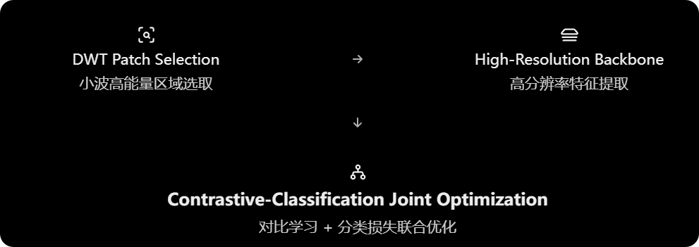
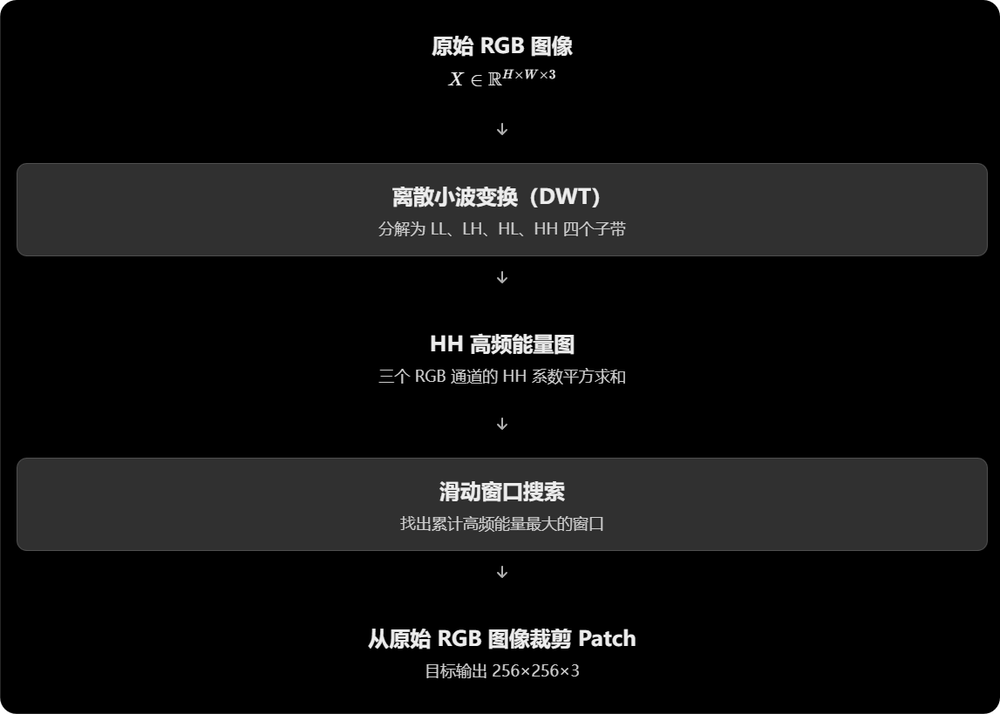
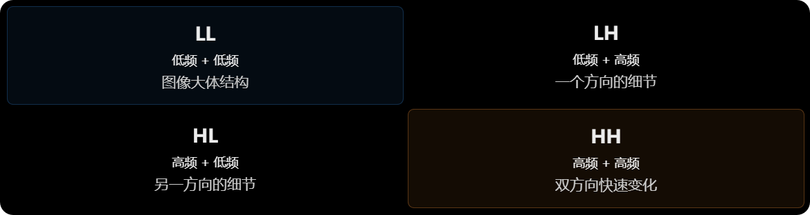
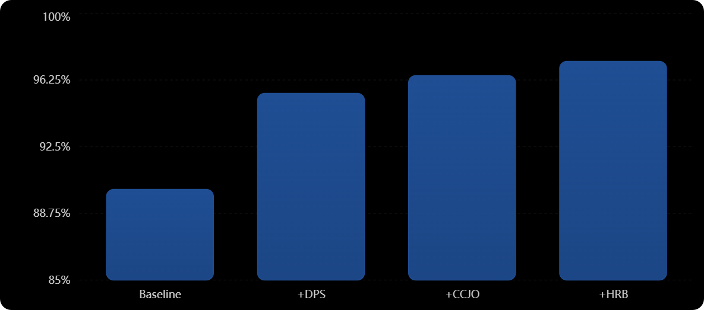
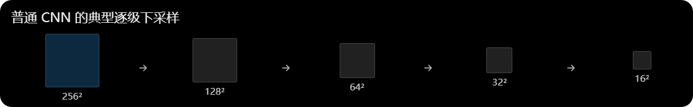
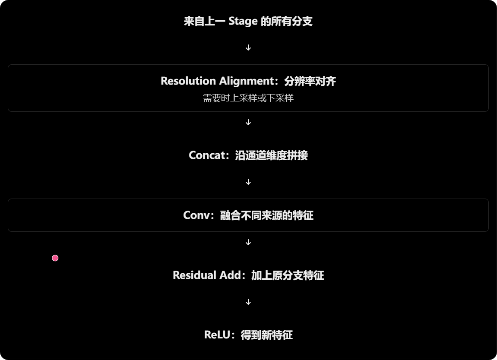
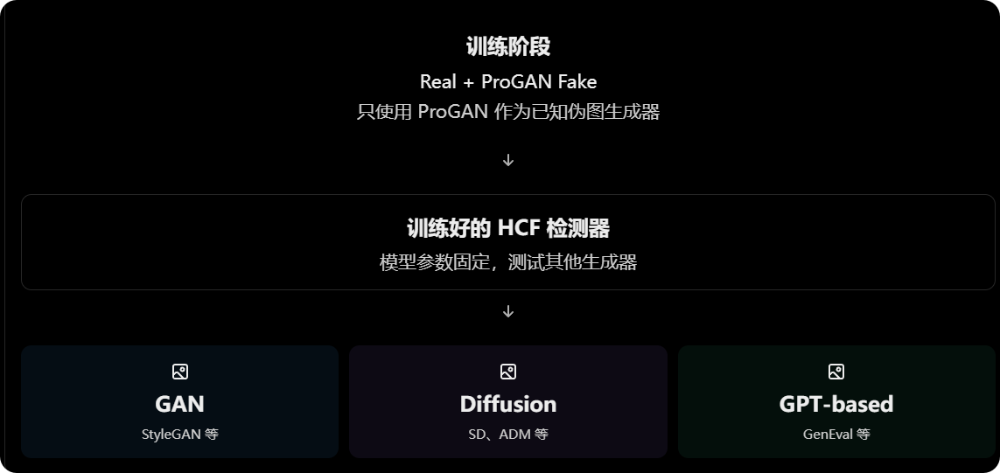

W. Wei et al., **“High-Resolution Contrastive Framework for Generalizable AI-Generated Image Detection,” ICASSP 2026.**

面向泛化性 AI 生成图像检测的高分辨率对比学习框架

## 理解

问题：为什么一个AI生成图像检测器在见过的生成模型上表现很好，但是换一个没见过的模型表现就会不及预期呢？

作者提出了两个主要原因：

1. 高频伪影丢失：图像缩放和卷积下采样破坏了用于判断真假的细微痕迹。

2. 特征纠缠：真实图像和未见过的 AI 生成图像在特征空间中混在一起，分类器难以区分。

为解决这些问题，作者提出 HCF（High-resolution Contrastive Framework），由三个模块构成。

## 论文精读

### 摘要与引言

问题 1：为什么下采样会影响 AI 图像检测？

假设有一张由 Stable Diffusion 生成的 1024×1024 图像。

这张图像看起来可能非常真实，但在一些细小纹理、像素相关性或频率分布上，仍可能留下生成过程产生的统计痕迹。

传统检测器通常把图像缩放到 224×224 或 256×256 后送入网络。

这样做的问题是：

- 一些细微纹理在缩小后被平滑或丢弃。
- 原本可区分真实图像和 AI 图像的高频线索可能遭到破坏。
- CNN 内部的步长卷积又可能进一步降低空间分辨率。

作者的核心判断：检测 AI 图像时，那些对人眼不显著的细微痕迹可能比整体语义内容更有用。

因此，HCF 不直接把整张大图缩小，而是尝试从原图中找出一个高频能量较强的局部区域，再利用高分辨率分支提取特征。

注意一个关键区别：高频能量强，并不必然代表这个区域包含 AI 生成伪影。 例如，真实图像中的头发、树叶也可能具有很强的高频能量。这是后面需要重点讨论的方法假设。

问题 2：什么叫特征纠缠（Feature Entanglement）？

你可以想象分类网络把每张图像都映射成一个特征向量。

但在实际训练中，假设检测器只见过 ProGAN 生成的图像，它可能学会的是 ProGAN 特有的痕迹，而不是真假图像之间更通用的差异。

当测试图片来自一个没有见过的扩散模型时，这些 Fake 图片的特征可能混入 Real 图片的区域。

这正是论文 Fig. 1(b) 想表达的现象。

作者因此加入 Supervised Contrastive Learning（监督对比学习）：

- 同类特征尽量靠近，例如不同生成器产生的 Fake 特征。
- 异类特征尽量分开，例如 Real 与 Fake。
- 再配合分类损失，让特征分离服务于真假检测。

这里需要注意：作者训练时只使用 ProGAN 这一种生成器作为伪图来源，因此监督对比学习并没有直接见过全部未知生成器。它能否让未知 Fake 也聚集在合适的特征区域，是要靠实验验证的泛化假设。

### 基于 DWT 的局部区域选择

#### 1. 模块的输入和输出

#### 2. DWT 介绍

DWT 全称 Discrete Wavelet Transform，即离散小波变换。

它可以将图像分解为不同方向的低频和高频信息。

以最常见的二维一级小波分解为例，得到四个子带：

这里作者选择使用HH子带，因为它包含水平和垂直方向的联合变化产生的高频信息。

#### 3. 公式 1：如何构造高频能量图

$$
E(i,j)=\sum_{c=1}^{3}{(HH_c(i,j))^2}
$$

$HH_c(i,j)$代表第c个颜色通道在（i，j）点上的HH小波系数。通过平方，我们可以将正负系数转换为非负的能量， 突出幅值更大的系数。

#### 4. 公式 2：如何通过滑动窗口找到最佳 patch

$$

  (x^*,y^*)= \underset{ \substack{ 0\leq x\leq W'-256\\ 0\leq y\leq H'-256 } }{\arg\max} \sum_{i=y}^{y+255} \sum_{j=x}^{x+255}E(i,j)

$$

其中：

- $H',W'$：能量图的高和宽；
- $(x,y)$：滑动窗口左上角坐标；
- $256$：能量图上滑动窗口的边长；
- $(x^*,y^*)$：使窗口累计能量最大的左上角位置

#### 5. 评价此模块

### 高分辨率骨干网络（HRB）

#### 1. 为什么要设计 HRB

前面我们了解到，DWT Patch Selection 主要解决的是输入预处理阶段的信息损失。但这还不够。假设我们成功从原图裁剪出了 256×256 的高频细节丰富区域，并送入一个普通 CNN：

传统 CNN 往往通过步长卷积和池化来降低特征图分辨率。虽然这有利于扩大感受野、控制计算量和提取高级语义，但也可能使细微的局部伪影难以保留。

HCF 的做法是：

始终保留一条相对高分辨率的特征分支，同时逐渐引入中、低分辨率分支，再让不同分辨率之间交换信息。

这里的“保留高分辨率”是相对于网络内部其他分支而言，不是说所有特征从头到尾都保持输入图像的 256×256 尺寸。

而且，HRB 本身也有卷积和 MaxPool，不能将其理解为“完全没有下采样”。

#### 2. 三个 Stage 如何变化

stage 1：只有高分辨率分支

输入首先经过 shallow stem（浅层特征提取部分）。

论文描述 stem 包含：

- Convolution Blocks
- Max Pooling

随后进入 Stage 1。

Stage 1 只有一条高分辨率分支，用于提取和细化较高空间分辨率的特征。

Stage 2：引入中分辨率分支

Stage 2 在原有高分辨率分支基础上，通过步长卷积生成新的、更低分辨率的分支。

此时网络有两条并行路径：

- High：保留更精细的空间特征；
- Medium：在更低分辨率上建模更大范围的上下文信息。

重点是，两条分支不是互相独立的。

它们会通过 Fusion-Transition 实现信息交流。

Stage 3：引入低分辨率分支

Stage 3 又增加一条 Low 分支，因此共有三条分支：

- High Resolution
- Medium Resolution
- Low Resolution

三条分支分别处理不同尺度的特征，同时通过对齐和融合操作交换信息。

#### 3. 公式 3：如何表示多分辨率特征

$$
X^{(s)}=\{x_1^{(s)},\ldots,x_s^{(s)}\}
$$

其中：

- $s$：Stage 编号，取 1、2、3；
- $X^{(s)}$：整个 Stage 的多分辨率特征集合；
- $x_i^{(s)}$：Stage $s$ 第 $i$ 条分支的特征。

#### 4. 公式 4：Fusion-Transition 做了什么

$$

x_i^{(s)} = \operatorname{ReLU} \left( \operatorname{Conv} \left( \operatorname{Concat} \left( A_{i,1}(x_1^{(s-1)}), \ldots, A_{i,s}(x_{s-1}^{(s-1)}) \right) \right) +x_i^{(s-1)} \right)
$$

分辨率对齐的目的在于将不同空间尺寸的分支拼接在一起，形成新的分支。对齐的方法包括通过上采样对齐和下采样对齐。
这里concat拼接是沿通道维度拼接，而非空间的宽度或者高度。

#### 5. 公式 5：跨分辨率对齐算子

$$
A_{i,j}(x_j)= \begin{cases} \operatorname{Down}(x_j),&R_j>R_i\\ x_j,&R_j=R_i\\ \operatorname{Up}(x_j),&R_j<R_i \end{cases}
$$

这里先把不同 Stage 的上标省略，方便理解。

- $i$：目标分支；
- $j$：来源分支；
- $R_i$：目标分支空间分辨率；
- $R_j$：来源分支空间分辨率。

#### 6. 公式 6：为什么把三个分支合在一起

经历 Stage 3 后，网络得到三条分支：

$$
x_1^{(3)},\quad x_2^{(3)},\quad x_3^{(3)}
$$

但检测器最终需要对每张图像生成一个可以进行分类和对比学习的特征表示。

因此作者设计了 High-frequency Representation Head（高频表示头）。

论文公式为：

$$
z=H\left( \operatorname{Concat} \left( x_1^{(3)}, \operatorname{Up}(x_2^{(3)}), \operatorname{Up}(x_3^{(3)}) \right) \right)
$$

其中 $H$ 代表用于细化融合特征的一组卷积块。

#### 7. 论文未交代清楚的细节

| 位置                | 论文已明确说明                       | 尚不明确的问题                          |
| ------------------- | ------------------------------------ | --------------------------------------- |
| Stem                | 包含卷积块和 MaxPool                 | 各层 kernel、stride、padding、通道数    |
| Stage 1             | 只有 High 分支                       | Residual Blocks 的数量和配置            |
| Stage 2             | 新增 Medium 分支                     | 精确通道数、跨分支融合的先后次序        |
| Stage 3             | 新增 Low 分支                        | 新分支如何处理残差连接                  |
| Fusion-Transition   | 对齐 → Concat → Conv → Add → ReLU    | 上采样方式、跨多级下采样的具体路径      |
| Representation Head | 上采样低分辨率特征后拼接，再卷积细化 | 输出通道、聚合到向量的操作              |
| 整体模型            | 论文报告参数量 1.95M                 | 能否依据正文完全复现这 1.95M 参数的网络 |

### 对比学习与分类联合优化

DWT-based patch selection能够尽量保留输入图像的高频细节，High Resolution backbone通过高分辨率路径与多尺度的融合，提取更加丰富的特征。但是提取出特征并不意味着模型能够泛化没见过的新的生成模型。所以作者需要解决第三个问题：
怎样让模型学到的特征，不只是能区分已经特别训练过的Real和Fake，还能够泛化到来自未知生成器的Fake。

#### 1. 为什么只用交叉熵不够

如果只用交叉熵损失，优化的目标主要是让训练样本的标签正确，并不能保证同类别的样本靠得足够近，也不能直接规定不同类别的特征之间必须间隔多大的距离。

作者认为当测试阶段出现未知的ProGAN和Diffusion模型时，Fake图像特征可能会落入real区域，导致产生错误分类。作者因此引入了对比监督学习。

#### 2. 数据增强：N 张图像为什么能产生 2N 个特征

给定一个N个样本的Batch，对每个样本使用随机变换算子T，得到新的数据增强视图。因此总共有2N个特征向量。

#### 3. 公式 7：正样本集合如何定义

$$
P(i)={\{f_{j}|i\neq j,y_i=y_j\}}
$$

i代表当前锚定样本Anchor，$f_j$是其他样本的特征向量，$y_{i,j}$为对应的标签。这里的正样本并不只是同一图像的增强版本，而是Batch中所有同类别的图像和增强视图。而负样本就是当前batch中除anchor特征以外的所有其他特征。

#### 4. 公式 8：负样本集合

$$
N(i)=A_{i}/P_{i}
$$

#### 5. 公式 9：监督对比损失的计算模式

$$
\mathcal L_{CL} = \sum_{i\in I} \frac{-1}{|P(i)|} \sum_{p\in P(i)} \log \frac{ \exp(f_i\cdot f_p/\tau) }{ \sum_{a\in A_i}\exp(f_i\cdot f_a/\tau) }
$$

第一步计算两个特征的相似程度，如果两个特征向量接近，并且具有适当的模长，那么它们的点积往往更大。再除以温度，一般来说温度越大，正样本权重越小。
第二步，分母是除了当前anchor以外的所有样本特征，包括正样本和负样本。加负号的原因是优化过程倾向于让正样本相对于其他候选样本获得更高的相似度权重。
第三步，对所有正样本求平均，就得到当前 Anchor 的损失
第四步，对所有的anchor进行计算，汇总就得到最终的结果。

#### 6. 公式 10：二分类交叉熵损失

对比学习负责约束特征空间，但是HCF的目的仍然是分辨出一个图像的真假。
因此，作者又设置了分类分支。

论文使用 Binary Cross-Entropy（BCE），即二分类交叉熵损失：

$$
\mathcal L_{CE} = -\frac1N \sum_{i=1}^{N} \left[ y_i\log p_i+ (1-y_i)\log(1-p_i) \right]
$$

其中：

- $N$：求和的样本数量；
- $y_i\in\{0,1\}$：真实标签；
- $p_i\in[0,1]$：分类器预测样本属于正类的概率。

这里设计real=0，Fake=1.并且模型预测的是样本为假的概率。

#### 7. 公式 11：如何联合优化两种损失

作者最终给出：

$$
\mathcal L = \lambda_{CE}\mathcal L_{CE} + \lambda_{CL}\mathcal L_{CL}
$$

两个超参数控制分类损失和对比损失的贡献。

### 实验与分析

作者希望验证的是只使用一个生成器来训练，也能检测来自许多未知生成模型的图像。

#### 1. 单生成模型训练

作者只使用单生成器训练范式：ProGAN。然后在其他生成器上测试：

#### 2. 评价指标（Acc、AP、mAcc）

Accuracy（Acc）：准确率

$$
Acc=\frac{TP+TN}{TP+TN+FP+FN}
$$

假设 Fake 为正类：

- TP：AI 生成图像被正确检测为 Fake。
- TN：真实图像被正确检测为 Real。
- FP：真实图像被错误检测为 Fake。
- FN：AI 生成图像被错误检测为 Real。

Average Precision（AP）：平均精度

AP 用于评价不同分类阈值下的 Precision–Recall 表现。

其中：

$$
Precision=\frac{TP}{TP+FP},\qquad Recall=\frac{TP}{TP+FN}
$$

AP 可以理解为对 PR 曲线按 Recall 增量进行加权汇总的指标。

Mean Accuracy（mAcc）

在论文的消融实验中使用了 mAcc。通常表示多个测试数据集上 Acc 的平均值：

$$
mAcc=\frac1K\sum_{k=1}^{K}Acc_k
$$
