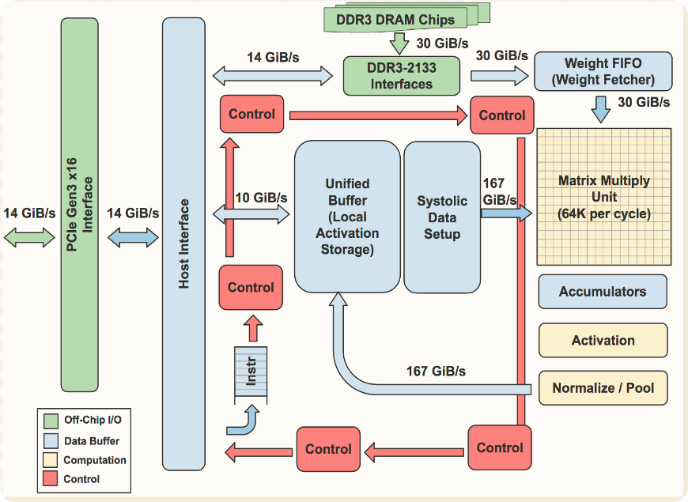
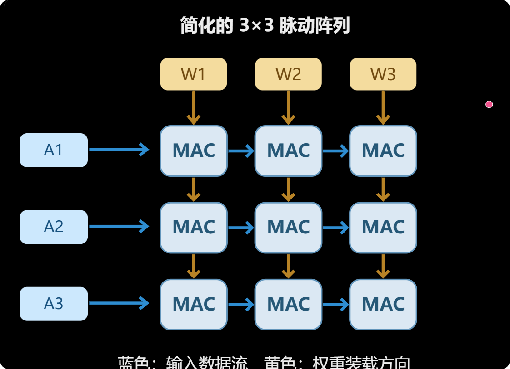
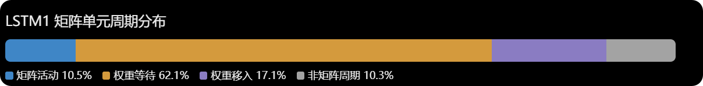
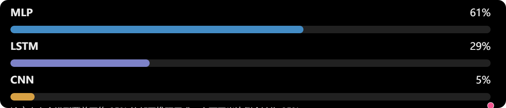
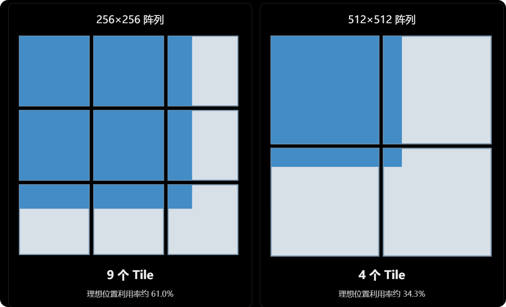
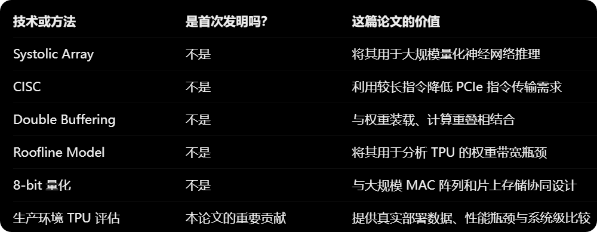

Norman P. Jouppi et al., **“In-Datacenter Performance Analysis of a Tensor Processing Unit,” ISCA 2017.**

论文链接：[arXiv:1704.04760](https://arxiv.org/abs/1704.04760) · [DOI](https://doi.org/10.1145/3079856.3080246)

这篇论文研究的是**第一代、面向推理的 Google TPU**，而不是后续支持训练的 TPU。它最值得学习的地方，不只是 65,536 个乘加单元和约 92 TOPS 的峰值算力，而是如何用真实生产负载回答一个体系结构问题：

> 在严格的响应时间约束下，领域专用硬件能否比同期 CPU/GPU 提供更高的性能和能效？限制实际收益的因素又是什么？

本文沿着“研究动机 → 硬件架构 → 性能分析 → 设计权衡 → 研究方法”整理阅读笔记。数值比较均限定在论文当时的平台、软件和工作负载下，不直接推广到今天的 CPU、GPU 或大模型推理。

## 一、研究动机：为什么专门为推理设计芯片？

### 从通用计算走向领域专用硬件

> Many architects believe that major improvements in cost-energy-performance must now come from domain-specific hardware.

当通用处理器越来越难以持续提供大幅度的性能与能效提升时，针对特定领域重新分配晶体管、存储和控制资源，就成为重要方向。

| 处理器 | 主要特点               | 设计取向                   |
| ------ | ---------------------- | -------------------------- |
| CPU    | 通用、灵活、控制能力强 | 处理多样化任务与复杂控制流 |
| GPU    | 大规模并行计算         | 依靠并行度获得高吞吐量     |
| TPU v1 | 为神经网络推理定制     | 高效执行低精度矩阵计算     |

论文介绍，2013 年 Google 预计，如果用户每天使用几分钟基于深度神经网络的语音搜索，现有数据中心的计算需求可能大幅增长。继续只靠 CPU 扩容成本很高，于是启动了面向推理的 ASIC 项目。

第一代 TPU 的几个核心数字是：

- **65,536 个 8-bit MAC 单元**，组成 $256\times256$ 的矩阵阵列。
- **700 MHz** 时钟频率。
- **约 92 TOPS** 峰值算力，按一次乘法、一次加法共两次操作计数。
- **28 MiB 主要片上数据存储**，由 24 MiB Unified Buffer 和 4 MiB Accumulators 构成。

但“拥有多少计算单元”不等于“每个周期都能有效使用多少计算单元”。实际性能还取决于内存带宽、矩阵形状、权重复用和流水线停顿。

### 神经网络为什么适合矩阵计算？

一个神经元可以表示为对加权和应用非线性函数：

$$
y=f\left(\sum_{i=1}^{n}w_i x_i\right)
$$

多个神经元合在一起，就可以写成矩阵形式：

$$
\begin{bmatrix}y_1\\y_2\end{bmatrix}
=
f\left(
\begin{bmatrix}
w_{11}&w_{12}&w_{13}\\
w_{21}&w_{22}&w_{23}
\end{bmatrix}
\begin{bmatrix}x_1\\x_2\\x_3\end{bmatrix}
\right)
$$

这里的 $f$ 按元素作用。大量乘法与累加，正是 MAC（Multiply-Accumulate，乘加）单元擅长的工作。

### Training 与 Inference 的差别

训练不仅要进行前向传播，还需要反向传播和权重更新，对数值表示、动态范围和计算灵活性有不同要求。

推理则使用已训练好的固定权重进行前向计算。对于论文所针对的模型，量化后可以采用低精度整数计算，减少乘法器面积、存储开销和数据搬运成本。

因此，TPU v1 重点优化 **Inference**。不过，“推理都可以无条件改用 8-bit”并不成立：量化是否可用，仍然需要验证模型精度。

### 三类真实生产负载

论文没有只选择容易跑出高性能的 CNN，而是使用了六个生产应用：

- **MLP（多层感知机）**：全连接层较多，涉及大量矩阵乘法。
- **CNN（卷积神经网络）**：卷积核在不同空间位置重复使用，通常具有较高的权重复用率。
- **RNN / LSTM（循环神经网络）**：计算依赖当前输入和历史状态，LSTM 通过门控控制信息的保留与遗忘。

| 模型  | 权重数量 | Ops / Weight Byte | TPU Batch Size |
| ----- | -------- | ----------------- | -------------- |
| MLP0  | 20M      | 200               | 200            |
| MLP1  | 5M       | 168               | 168            |
| LSTM0 | 52M      | 64                | 64             |
| LSTM1 | 34M      | 96                | 96             |
| CNN0  | 8M       | 2888              | 8              |
| CNN1  | 100M     | 1750              | 32             |

以上数值沿用论文 Table 1。第三列是论文定义的 **Operational Intensity（运算强度）**：每读取一字节权重，完成多少次操作。它不是泛指所有存储层次上的总字节流量。

这六个应用代表了当时约 95% 的 TPU 工作负载。其代表性来自真实部署分布，而不是模型名字是否流行。

## 二、硬件架构：让矩阵单元持续工作

### 为什么设计成协处理器？

TPU 没有与 CPU 深度集成，而是作为 **Coprocessor（协处理器）**，通过 PCIe Gen3 x16 接入已有服务器。

这样设计有两个直接好处：

1. 可以插入现有服务器，降低部署难度。
2. 由 Host CPU 发送指令，TPU 不必自己承担完整的指令获取与复杂控制工作。

作者因此认为，它在设计思想上更接近 FPU 协处理器，而不是 GPU。不过，TPU 的目标并不是只执行一个独立乘法，而是尽可能运行完整的推理模型，减少与 Host CPU 的交互。

### 存储层次与数据流

| 模块           | 容量              | 主要作用                   |
| -------------- | ----------------- | -------------------------- |
| Weight Memory  | 8 GiB，片外 DRAM  | 存放模型权重               |
| Weight FIFO    | 4 个权重 Tile     | 缓冲即将送入矩阵单元的权重 |
| Unified Buffer | 24 MiB，片上 SRAM | 存放输入及中间激活值       |
| Accumulators   | 4 MiB，片上       | 存放 32-bit 累加结果       |

这里需要区分两条输入路径：

- **权重路径**：Weight Memory → Weight FIFO → Matrix Multiply Unit。
- **激活值路径**：Host Memory / 上一层输出 → Unified Buffer → Matrix Multiply Unit。

矩阵单元产生的部分和进入 Accumulators，经过激活函数、必要的池化等处理后，结果写回 Unified Buffer，供后续网络层使用。

因此，不能把这代 TPU 的 Unified Buffer 简单理解成“权重和激活值都从这里进入阵列”。权重有独立的数据通路。

### Matrix Multiply Unit 与脉动阵列

核心计算单元由 $256\times256$ 个 MAC 构成，支持 8-bit 整数乘加；乘积使用更宽的累加器累加，避免把部分和也限制在 8-bit 中。

如果每次乘加都要从大容量 SRAM 读取操作数和部分和，再把结果写回，数据访问的能耗会非常可观。因此，TPU 使用 **Systolic Array（脉动阵列）**，让数据沿相邻计算单元有节奏地传递。

上图是帮助理解局部传递的简化图，不是 TPU 完整的逐周期时序。在实际 TPU 中，权重从上方装载，输入从左侧进入，计算以波前形式推进。权重装载后可以被重复使用，不是每次乘加都重新从片外 DRAM 获取。

这种组织方式的关键价值是：**减少对大存储器的反复访问，让数据复用更多地发生在阵列内部。**

### 指令数量少，不等于 RISC

TPU 总共只有十余种指令，但采用的是 **CISC 风格的粗粒度指令**，不是“精简指令集 RISC”。

这里的 CISC 强调一条指令能够控制较大规模、持续多个周期的操作，从而减少通过 PCIe 传输指令的开销。主要指令包括：

| 指令                      | 功能                                              |
| ------------------------- | ------------------------------------------------- |
| `Read_Host_Memory`        | 将主机内存中的数据读入 Unified Buffer             |
| `Read_Weights`            | 将片外权重读入 Weight FIFO                        |
| `MatrixMultiply/Convolve` | 执行矩阵乘法或卷积，结果进入 Accumulators         |
| `Activate`                | 执行激活函数及相关操作，将结果写回 Unified Buffer |
| `Write_Host_Memory`       | 将结果写回主机内存                                |

“指令种类少”和“每条指令的语义简单”是两回事。

### 流水线与数据依赖

> The philosophy of the TPU microarchitecture is to keep the matrix unit busy.

TPU 使用四阶段流水线，尝试重叠权重读取、矩阵计算和其他操作。权重读取与执行可以解耦，双缓冲也有助于隐藏下一块权重的装载时间。

不过，这不是传统意义上“每个阶段固定一个周期”的简单流水线。一条粗粒度指令可能占用执行阶段很久；如果下一层依赖上一层尚未写回的激活值，或权重没有准备好，矩阵单元仍然需要等待。

### 为什么理想情况下每周期输出 256 个分量？

一个输出分量需要 256 次乘加：

$$
c_{ij}=\sum_{k=0}^{255}a_{ik}w_{kj}
$$

一行包含 256 个输出分量，计算工作量是：

$$
256\times256=65{,}536\ \text{MAC}
$$

这与阵列的 MAC 数量相匹配。因此，在流水线稳定、数据充足且阵列满负荷的理想状态下，可以达到每周期产生一组 256 个部分和的吞吐率。

但这不意味着一个独立输出从输入到完成只需要一个周期。**流水线吞吐率与单次计算延迟不能混为一谈。**

### 92 TOPS 是如何计算的？

阵列数量和时钟频率分别为：

$$
N_{\mathrm{MAC}}=256^2=65{,}536,\qquad f=700\ \mathrm{MHz}
$$

按照一次 MAC 包含乘法、加法两次操作的口径：

$$
P_{\mathrm{peak}}
=65{,}536\times2\times700\times10^6
\approx91.75\times10^{12}\ \mathrm{Ops/s}
\approx92\ \mathrm{TOPS}
$$

这个数字是峰值，不是每个模型的实际吞吐量。

论文还提到，形状为 $B\times256$ 的输入乘以 $256\times256$ 的权重，可以在 $B$ 个流水化计算周期内处理完成。这里描述的是稳定流水执行的计算吞吐，不能将它理解为包含权重装载、流水线填充、同步和主机交互的完整端到端耗时。

## 三、性能分析：高峰值为什么不等于高利用率？

### 用 Roofline 区分计算瓶颈和带宽瓶颈

Roofline 模型给出一个性能上界：

$$
P\leq\min\left(P_{\mathrm{peak}},\mathrm{BW}\times I\right)
$$

其中：

- $P_{\mathrm{peak}}$：处理器峰值计算吞吐量。
- $\mathrm{BW}$：相应存储层次的带宽，单位为 Byte/s。
- $I$：运算强度，单位为 Ops/Byte。

当运算强度低时，数据供给限制性能，对应 Roofline 的斜线部分；当运算强度足够高时，才可能接近计算峰值，对应水平部分。

论文将 TPU 的分析重点放在**每读取一字节权重所完成的操作数**上，并在 Figure 5–7 中给出以下拐点：

| 处理器         | 论文标注的 Roofline 拐点 |
| -------------- | ------------------------ |
| Haswell CPU    | 约 13 Ops/Byte           |
| NVIDIA K80 GPU | 约 9 Ops/Byte            |
| TPU            | 约 1350 Ops/Byte         |

这里沿用原图的 operations/byte 标注，不将它直接改写成 MAC/Byte。尤其在比较 TOPS、MAC/s 和运算强度时，必须统一“一次乘加算几次操作”的计数口径。

TPU 的拐点远高于 CPU/GPU，不代表 TPU 更慢。拐点只反映**计算峰值与带宽的比例**：TPU 的计算阵列很强，但相对而言，权重带宽不够宽裕，需要更高的数据复用才能充分利用阵列。

反过来，CPU/GPU 的拐点更靠左，也不意味着实际应用一定能够达到各自的理论上界。

### 时钟周期究竟浪费在哪里？

论文 Table 3 的性能计数器提供了比峰值数字更有解释力的证据：

| 性能计数器              | LSTM1 | CNN0  | CNN1  |
| ----------------------- | ----- | ----- | ----- |
| Array active cycles     | 10.5% | 78.2% | 46.2% |
| Useful MACs（相对峰值） | 6.3%  | 78.2% | 22.5% |
| Weight stall cycles     | 62.1% | 0%    | 28.1% |
| Weight shift cycles     | 17.1% | 0%    | 7.0%  |
| Non-matrix cycles       | 10.3% | 21.8% | 18.7% |
| RAW stalls              | 10.6% | 3.5%  | 22.8% |
| 实际 TOPS               | 2.8   | 86.0  | 14.1  |

**这些百分比不能全部直接相加。** Array active、Weight stall、Weight shift 和 Non-matrix 是一组周期分类，合计约为 100%；Useful MACs 是对阵列有效工作的进一步刻画，RAW stalls 则是可能重叠的相关性停顿计数。

另外，论文说明 TOPS 来自生产代码测量，其他行来自性能计数器测量，两组数据并不完全一致。因此不能机械地用“92 TOPS × Useful MACs”推导出最后一行。

#### LSTM1：主要在等权重

LSTM1 的阵列活动周期只有 10.5%，等待权重占 62.1%，权重移入又占 17.1%。

因此，单纯增加 MAC 数量很可能不能解决问题：计算单元已经在“等数据”，更大的阵列只会让更多单元一起等待。提高权重带宽、改善复用或调度才更有针对性。

#### CNN1：平均运算强度高，也可能存在局部瓶颈

CNN1 的阵列活动周期为 46.2%，但有效 MAC 比例只有 22.5%，说明部分计算单元没有承担有效工作。同时，它还有权重等待和 RAW（Read After Write，写后读）数据依赖停顿。

论文指出，其中一些层的特征深度较浅，不能填满整个阵列；四个全连接层的运算强度也远低于模型整体平均值。

这说明：**模型级平均运算强度会掩盖层与层之间的差异。** 分析实际瓶颈时，还要看矩阵形状、分层行为和执行依赖。

### 在线推理为什么受尾延迟约束？

> Inference prefers latency over throughput.

对于直接服务用户的在线推理，目标通常不是无条件最大化吞吐量，而是：

> 在满足 P99 响应时间约束的前提下，尽可能提高吞吐量。

P99 表示第 99 百分位延迟，即约 99% 的请求延迟不超过该值。剩余最慢的一小部分请求构成尾部，平均延迟往往无法充分反映它们的体验。

增大 Batch 可以提高权重复用和并行度，却也会增加请求等待或计算时间。论文 Table 4 中，MLP0 的响应时间要求约为 7 ms：

| 平台    | Batch | P99 响应时间 | 每秒推理数 |
| ------- | ----- | ------------ | ---------- |
| K80 GPU | 16    | 6.7 ms       | 13,461     |
| K80 GPU | 64    | 8.3 ms       | 36,465     |
| TPU     | 200   | 7.0 ms       | 225,000    |
| TPU     | 250   | 10.0 ms      | 280,000    |

更大的 Batch 确实提高了吞吐量，但超出延迟要求的性能并不能直接用于线上服务。这里的数值包含主机时间，不能与仅统计芯片内部计算的 TOPS 混用。

论文还举出 LSTM1 的例子：开发者最初提出的延迟限制是 10 ms，实际移植到 TPU 时收紧到了 7 ms。硬件不能假设应用总会允许足够大的 Batch。

TPU 的简化、可预测执行方式有助于满足尾延迟要求，但它同样受到 Batch、数据依赖和主机交互的限制。

### CPU、GPU、TPU 的真实相对性能

论文 Table 6 给出的相对性能按芯片归一化，并包含加速器的主机开销：

| 模型  | K80 GPU / CPU | TPU / CPU | TPU / GPU |
| ----- | ------------- | --------- | --------- |
| MLP0  | 2.5×          | 41.0×     | 16.7×     |
| MLP1  | 0.3×          | 18.5×     | 60.0×     |
| LSTM0 | 0.4×          | 3.5×      | 8.0×      |
| LSTM1 | 1.2×          | 1.2×      | 1.0×      |
| CNN0  | 1.6×          | 40.3×     | 25.4×     |
| CNN1  | 2.7×          | 71.0×     | 26.3×     |

各列沿用论文公布的舍入值，不能要求舍入后再相除仍完全一致。

LSTM1 上，TPU 相对 CPU 只快约 1.2 倍，与其权重供给瓶颈一致。CNN1 虽然没有充分发挥 TPU 峰值，仍然比当时的 CPU 快约 71 倍。

这里必须区分三个概念：

1. **绝对性能**：实际完成了多少工作。
2. **硬件利用率**：使用了多少峰值能力。
3. **相对性能**：与某个基准平台相比快多少。

利用率不高，不代表一定比别的处理器慢；相对加速比很高，也不代表硬件已经没有优化空间。

### 几何平均与工作负载加权平均

| 平均方式                 | GPU / CPU | TPU / CPU | TPU / GPU |
| ------------------------ | --------- | --------- | --------- |
| GM（几何平均）           | 1.1×      | 14.5×     | 13.2×     |
| WM（按实际负载占比加权） | 1.9×      | 29.2×     | 15.3×     |

几何平均适合汇总多个基准测试的相对速度比，避免像算术平均那样过度受极大倍率支配。

但数据中心中不同模型的使用频率不同，因此作者还使用实际工作负载分布进行加权：

MLP 约占 61%，LSTM 约占 29%，CNN 约占 5%；合计为论文六个代表性应用覆盖的约 95%，并非全部负载。

GM 与 WM 得到明显不同的结果，说明**体系结构评价高度依赖工作负载分布**。如果只用一个 CNN 来评价 TPU，就可能错过数据中心中更常见的带宽受限场景。

## 四、能效：芯片更省电，系统就一定更划算吗？

> When buying computers by the thousands, cost-performance trumps performance.

对数据中心来说，真正重要的经济指标是 **TCO（Total Cost of Ownership，总拥有成本）**，包括采购、供电、制冷、维护等长期成本。

Google 无法公开大规模采购价格，因此论文使用 Performance/Watt 作为 Performance/TCO 的代理指标：

$$
\mathrm{Performance/Watt}=\frac{\text{性能}}{\text{功率}}
$$

但两者不等价。能效只能解释部分成本，不能直接得出完整的经济收益。

### Total 与 Incremental 两种口径

**Total Performance/Watt（总能效）**包含整个服务器的功耗：

$$
\eta_{\mathrm{total}}=
\frac{\text{服务器推理吞吐量}}{\text{服务器总功率}}
$$

**Incremental Performance/Watt（增量能效）**则在计算加速器配置能效前，扣除基础 Host CPU 服务器的功率：

$$
\eta_{\mathrm{inc}}=
\frac{\text{加速配置的推理吞吐量}}
{\text{加速配置总功率}-\text{基础主机服务器功率}}
$$

这是论文采用的比较口径，不意味着实际运行时可以拔掉 Host CPU，仍然完成相同工作。

| 比较口径                     | TPU 相对 CPU | TPU 相对 GPU |
| ---------------------------- | ------------ | ------------ |
| Total Performance/Watt       | 17–34×       | 14–16×       |
| Incremental Performance/Watt | 41–83×       | 25–29×       |

这里的范围对应论文中不同汇总方式的结果，不是测量置信区间。

为什么两种口径差距很大？因为加速器本身功耗较低时，服务器基础功耗可能相当可观。把整个系统算进去后，低功耗加速器的优势会被主机功耗部分稀释。

因此，评估硬件时必须问清楚：**测的是芯片、加速卡，还是完整服务器？是否包含主机开销？**

## 五、设计空间探索：更多 MAC 未必更快

这一部分主要来自经过实测校验的**性能模型预测**，不是作者真的制造了所有参数组合的芯片。

作者先比较模型与硬件性能计数器的周期差异，六个应用的平均差异约为 8%，再改变硬件参数进行敏感性分析。

| 方案      | 改变内容                                    |
| --------- | ------------------------------------------- |
| `memory`  | 增加权重内存带宽                            |
| `clock`   | 提高时钟频率                                |
| `clock+`  | 提高频率，并相应增加 Accumulators           |
| `matrix`  | 扩大矩阵计算阵列                            |
| `matrix+` | 扩大阵列，并按计算单元规模增加 Accumulators |

### 增加带宽最有效

当权重内存带宽提高到 4 倍时，模型预测六个应用的加权平均性能约提高 3 倍。这说明原始设计的进一步优化空间，很大程度上在于数据供应，而不只是计算峰值。

需要注意，论文这部分敏感性分析不包含完整的 Host CPU 执行时间，不能直接把芯片级收益视为端到端服务收益。

### 提高频率的平均收益有限

如果权重带宽不变，对带宽受限的 MLP 和 LSTM 而言：

$$
P_{\mathrm{attainable}}\leq\mathrm{BW}\times I
$$

提高计算峰值并没有改变右侧上界。因此，时钟提高 4 倍，对这些模型几乎没有帮助；对计算受限的 CNN，则有约 2 倍的性能提升。

这个结果说明：**加速非瓶颈部分，不一定能改善整体性能。**

### 扩大阵列甚至可能变慢

从 $256\times256$ 扩大到 $512\times512$，MAC 数量增加 4 倍，但论文模型中的平均性能反而略有下降。

原因之一是二维分块带来的内部碎片。以 LSTM1 中的 $600\times600$ 矩阵为例：

- 使用 $256\times256$ 阵列，需要 $3\times3=9$ 个 Tile。
- 使用 $512\times512$ 阵列，需要 $2\times2=4$ 个 Tile。

Tile 数量减少了，但每个 Tile 更大，边缘空置的计算位置也更多：

只看几何位置利用率，分别为：

$$
U_{256}=\frac{600^2}{9\times256^2}\approx61.0\%
$$

$$
U_{512}=\frac{600^2}{4\times512^2}\approx34.3\%
$$

这些百分比只是分块示例的位置利用率，不是完整程序实测的 MAC 利用率。真正运行时还要考虑更大权重块的加载成本：论文举例中，9 个小块总计约 18 微秒，4 个大块却需要约 32 微秒。

所以“并行计算单元越多越快”的前提，是矩阵形状、带宽和调度都能与它匹配。

### 软件优化也会改变 SRAM 需求

论文 Table 8 给出改进存储分配器后，各模型对 Unified Buffer 的最大使用量：

| 模型  | 最大使用量 |
| ----- | ---------- |
| MLP0  | 11.0 MiB   |
| MLP1  | 2.3 MiB    |
| LSTM0 | 4.8 MiB    |
| LSTM1 | 4.5 MiB    |
| CNN0  | 1.5 MiB    |
| CNN1  | 13.9 MiB   |

因此，对这六个应用和改进后的分配器来说，约 14 MiB 已经足够，而原设计是 24 MiB。

这并不意味着当初的额外容量毫无价值：早期分配器尚未成熟时，系统确实使用了更大的空间；剩余容量也给更大模型留下了余量。

真正的启示是：**编译器、内存分配器和调度算法的进步，可能直接改变硬件所需的存储容量。**

## 六、Discussion：哪些直觉容易误导架构设计？

论文用 Fallacy 和 Pitfall 组织讨论：前者是看似合理但被证据反驳或削弱的认识，后者是容易导致设计或评测偏差的做法。

### 误区一：数据中心推理同样重视吞吐量与响应时间

在线服务往往先要求满足响应时间，再讨论最大吞吐量。不能为了填满计算阵列，就假设应用可以无限增大 Batch。

当然，这个判断针对论文中的在线推理场景。离线批处理的目标可能不同，不能一概而论。

### 误区二：高吞吐 GPU 天然适合所有推理任务

K80 的大量并行线程和高带宽内存能够提供很高的吞吐潜力，但严格延迟要求会限制 Batch，导致潜力无法充分发挥。

这说明的是**当时 K80 与特定生产推理负载的匹配问题**，不是“所有 GPU 都不适合推理”。现代 GPU 的低精度计算能力和软件栈已经发生了很大变化。

### 陷阱一：只研究 CNN，忽略真实负载分布

论文指出，当时很多神经网络硬件研究集中在 CNN，但 Google 的 TPU 负载中，MLP 和 LSTM 占据更大比例。

学术热点、竞赛模型与生产环境需求并不总是一致。只选择高复用的 CNN，可能高估计算阵列收益，低估权重带宽的重要性。

### 陷阱二：只用 IPS 比较不同网络的硬件效率

IPS（Inferences Per Second）表示每秒完成多少次推理，但不同模型单次推理的计算量可能相差很大：

| 模型 | 层数 | TPU 推理吞吐量 |
| ---- | ---- | -------------- |
| MLP1 | 4    | 360,000 IPS    |
| CNN1 | 89   | 4,700 IPS      |

两者相差约 75 倍，不意味着执行 MLP1 时的硬件计算效率就是 CNN1 的 75 倍。

更合理的比较应结合：

- 相同模型、精度和配置下的 IPS。
- 平均延迟及 P99 等尾延迟指标。
- 实际计算吞吐量和有效硬件利用率。
- 芯片与系统层面的功耗、能效。
- 多种代表性负载上的整体表现。

### 误区三：开启 GPU Boost 就能改变结论

论文讨论了 K80 开启 Boost 后的情况，报告的能效收益约为 8%。提高频率能改善部分性能，但不必然带来同等幅度的能效提升，也没有自动解决延迟与工作负载匹配问题。

数据中心还必须考虑供电、散热和服务器配置，不能只比较单个芯片的最高运行频率。

### 误区四：优化实现或换新硬件就能直接证明结果相近

CPU/GPU 与 TPU 的差距并不只来自微架构：数据精度、软件实现、批大小和部署条件也影响结果。

论文中的 CPU 结果主要使用浮点计算，而 TPU 使用低精度整数计算。这是实际系统方案的比较，不能把全部差距都归因于某一个硬件结构。

作者也讨论了具有更强 8-bit 整数计算能力的 NVIDIA P40，但它不是 TPU 部署时的同期硬件，论文也没有给出相同 P99 约束下的完整测试。因此，不能用它的理论峰值直接替换 K80 的实测结果。

## 七、从论文中学习研究方法

### 研究问题与假设

这篇论文的中心问题是：针对有严格响应时间要求的数据中心神经网络推理，领域专用 ASIC 能否显著改善性能和能效？收益由哪些架构因素决定？

可以把它整理为三个待验证的假设：

1. **领域专用硬件能带来显著收益。** 通过低精度矩阵阵列、片上存储和简化控制，减少通用计算的部分开销。
2. **可预测的执行方式有助于满足尾延迟要求。** 高峰值吞吐不一定能转化为严格 P99 约束下的可用性能。
3. **下一步优化可能更依赖数据供给。** 带宽受限的模型不会因为 MAC 数量增加就自动变快。

阅读时不能只记住这些结论，而要找到相应的证据。

### 实验设计与证据链

| 层次         | 论文采用的方法                            | 能回答什么问题                   |
| ------------ | ----------------------------------------- | -------------------------------- |
| 真实工作负载 | 六个生产推理应用，覆盖 MLP、LSTM、CNN     | 测试是否具有代表性？             |
| 同期硬件基线 | Haswell E5-2699 v3、K80、第一代 TPU       | 相对于当时可部署方案是否有收益？ |
| 服务约束     | Batch 与 P99 响应时间联合评测             | 性能是否能用于真实在线服务？     |
| 多维指标     | TOPS、IPS、延迟、利用率、Performance/Watt | 算得快、用得满和省电是否一致？   |
| 性能计数器   | 阵列活动、权重等待、RAW 停顿等            | 时间究竟消耗在哪里？             |
| 性能模型     | 调整带宽、时钟、阵列与累加器容量          | 哪些设计改动最值得尝试？         |

以 LSTM1 为例，证据链可以写成：

**低运算强度 → 权重等待占比高 → 阵列活动少 → 提高计算峰值作用有限 → 增加带宽更有效。**

这比“TPU 跑 LSTM1 不够快”更有研究价值，因为它给出了可检验的原因和下一步优化方向。

### 创新不一定意味着发明全新的电路

脉动阵列、CISC、双缓冲、Roofline 和低精度量化，都不是这篇论文首次提出的概念。

它的重要贡献在于：**围绕真实推理场景，将这些思想整合成可部署的系统，并用生产负载、服务约束和性能计数器解释其收益与局限。**

### 需要保留的研究边界

- 这是第一代 TPU 的推理研究，不覆盖后续训练架构。
- 六个生产应用具有代表性，但不代表所有神经网络，更不代表今天的 Transformer 和大模型服务。
- 峰值、计数器、生产吞吐量和主机开销来自不同层次，必须区分测量口径。
- 参数扩展与假想改进方案主要来自性能模型，不能当成新芯片实测结果。
- Performance/Watt 只是 TCO 的代理，无法完整表达采购与运营成本。

## 总结：评价加速器，要从工作负载出发

这篇论文给我最重要的启示是：**AI 加速器的性能不是由 MAC 数量单独决定的，而是工作负载、数据流、存储层次和服务约束共同作用的结果。**

以后阅读类似论文，可以沿着下面的检查清单展开：

1. **Problem**：作者解决什么问题？现有方案的瓶颈是什么？
2. **Workload**：针对哪些模型、算子、矩阵形状、Batch 和精度？
3. **Architecture**：计算单元如何组织？存储层次和数据流如何设计？
4. **Data Movement**：权重、激活值、部分和分别如何移动与复用？
5. **Evaluation**：基线是否合适？是否包含主机开销和尾延迟约束？
6. **Evidence**：哪些结论来自实测，哪些来自模型、仿真或推论？
7. **Trade-offs**：性能收益需要付出多少面积、带宽、功耗和复杂度？
8. **Limitations**：哪些工作负载没有测试？哪些假设限制了结论？
9. **Research Idea**：继续研究时，最值得改进的是算力、数据供给，还是软件调度？

对于 TPU v1，答案很清楚：不要只盯着 92 TOPS。先看数据能否及时到达阵列，再看这些计算能否在用户允许的时间内完成。

## 参考资料与图片来源

- Jouppi, N. P. et al. [In-Datacenter Performance Analysis of a Tensor Processing Unit](https://arxiv.org/abs/1704.04760). ISCA 2017. DOI: [10.1145/3079856.3080246](https://doi.org/10.1145/3079856.3080246)。文中表格数据与定量结论主要据论文 Table 1、3、4、6、8 及相关正文整理。
- 正文插图迁移自原始阅读笔记；架构图用于说明 TPU 结构，其余示意图用于辅助理解，不应视作额外的实测结果。
- 封面：吉卜力工作室官网公开的[《千与千寻》场景图](https://www.ghibli.jp/works/chihiro/)（[原图 chihiro003.jpg](https://www.ghibli.jp/gallery/chihiro003.jpg)）。官网说明“画像は常識の範囲でご自由にお使いください”（请在常识范围内自由使用）；版权归原权利人所有，非 CC 或公共领域图片。封面仅作装饰，与论文内容无关。
